# Auth & Permission Architecture

> 本文档详细分析 auth-service 的用户管理、权限配置、菜单按钮关联、登录登出会话管理、接口权限管控的完整架构。

---

## 一、用户创建与管理

### 1.1 用户聚合根模型

```
UserAggregate
├── userId: UserId                    # 聚合根ID
├── userNo: UserNo                    # 业务编号（全局唯一）
├── userType: UserType                # AGENT | OPERATOR | TELLER
├── userStatus: UserStatus            # ACTIVE | FROZEN | DISABLED
├── identityDocument: IdentityDocument # 身份证件
│   ├── documentType: DocumentType    # ID_CARD | PASSPORT | ...
│   └── documentNo: String
├── contactInfo: ContactInfo          # 联系信息
│   ├── mobile: String
│   ├── email: String
│   └── name: String
├── createdAt: LocalDateTime
├── updatedAt: LocalDateTime
└── version: int                      # 乐观锁
```

- **UserType**: AGENT（代理人）、OPERATOR（操作员）、TELLER（柜员）
- **UserStatus**: ACTIVE（正常）、FROZEN（冻结）、DISABLED（停用）
- 工厂方法 `create()` 创建用户，初始状态为 ACTIVE
- 生命周期方法: `freeze()` 冻结、`activate()` 激活、`disable()` 停用

### 1.2 用户生命周期与领域事件

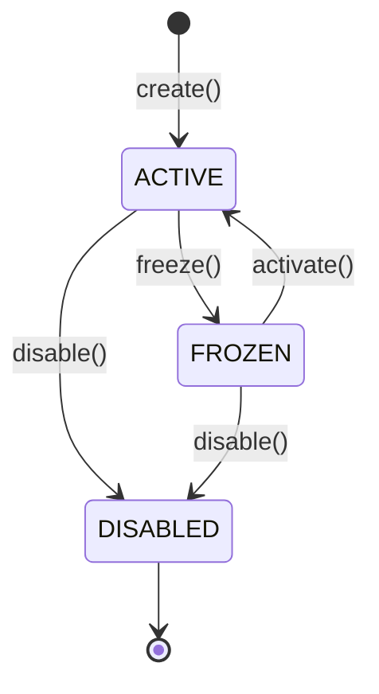

| 事件 | 触发时机 | 业务效果 |
|------|---------|---------|
| UserActivated | activate() 或 create() | 允许登录 |
| UserFrozen | freeze() | 立即踢出所有会话 |
| UserDisabled | disable() | 禁止登录 |

### 1.3 冻结"双杀"机制

冻结操作需要同步完成两件事，确保被冻结用户无法继续操作：

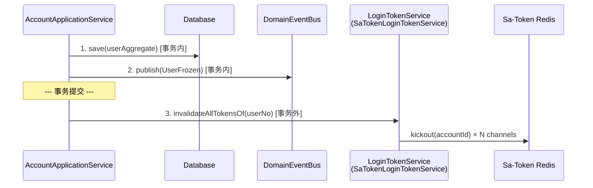

**关键设计决策**:
- Token 失效操作在事务外执行 — Sa-Token 操作不参与业务事务
- 冻结优先级高于踢出失败 — 即使踢出失败，用户状态已冻结，下次 token 校验也会失败
- 踢出失败可重试或依赖 token TTL 自然过期

---

## 二、凭证管理

### 2.1 凭证模型（sealed abstract）

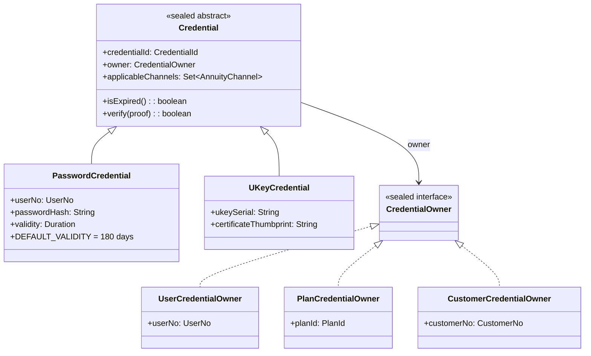

**所有者多态**:
- `PasswordCredential` 始终为 `UserCredentialOwner`（密码属于个人）
- `UKeyCredential` 可为 `PlanCredentialOwner` / `CustomerCredentialOwner` / `UserCredentialOwner`（UKey 可归属不同层级）

### 2.2 身份解析服务

`IdentityResolutionService` 是所有四种登录场景的统一入口：

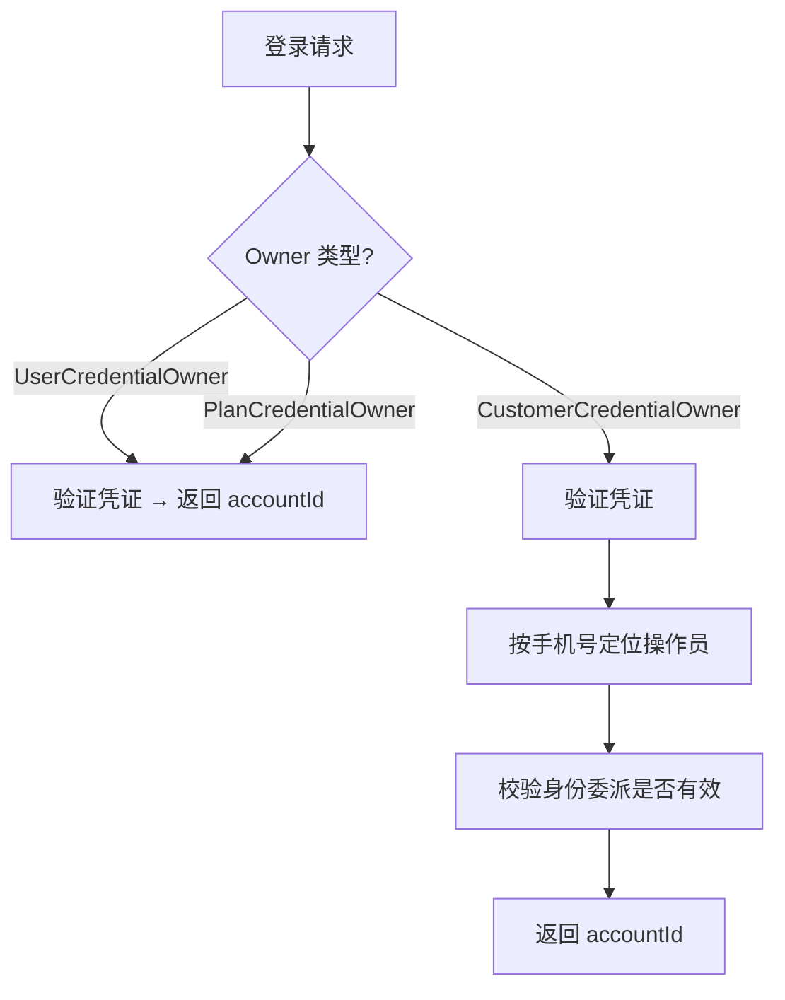

- **账户级所有者** (User/Plan): 验证 → 直接返回 accountId
- **客户级所有者** (Customer): 验证 → 通过手机号定位操作员 → 校验身份委派 → 返回 accountId

---

## 三、身份委派与角色模板

### 3.1 身份委派 (AgentIdentityAssignment)

```
AgentIdentityAssignment
├── assignmentId: AssignmentId
├── userNo: UserNo              # 谁
├── roleCode: String            # 扮演什么角色
├── scopeDimension: ScopeDimension  # 作用域维度
│   └── PLAN | CUSTOMER | PRODUCT | GLOBAL
├── scopeValue: String          # 作用域值
├── inheritable: boolean        # 是否级联到子客户
├── status: AssignmentStatus    # ACTIVE | DEACTIVATED
└── version: int
```

核心语义: "某人在某范围内扮演某角色"

- `changeRole()` / `deactivate()` 为包内可见，仅 `GrantProvisioningService` 可调用
- 发出领域事件: AssignmentCreated, AssignmentDeactivated, AssignmentRoleChanged

### 3.2 角色模板 (RoleTemplate)

```
RoleTemplate
├── roleCode: String                    # 角色编码（唯一）
├── scopeDimension: ScopeDimension      # 适配的作用域维度
├── scopeValue: String                  # 适配的作用域值
├── permissions: Set~Permission~        # 授权的权限集
└── status: RoleStatus                  # EFFECTIVE | DISABLED
```

- **静态配方**: (roleCode, scopeDimension, scopeValue) → Set<Permission>
- **解析优先级**: PLAN > CUSTOMER/PRODUCT > GLOBAL
- **变更即生效**: 角色模板修改后，下次权限检查自动使用新定义（无需回填 Grant）

### 3.3 角色可见性 (RoleVisibility)

控制管理后台下拉框中哪些角色可见:
- `SHOW_ALL`: 全局作用域角色可见
- `EXCLUSIVE_ONLY`: 特定客户作用域角色独占可见

---

## 四、授权策略 (Grant)

### 4.1 Grant 模型

```
Grant
├── grantId: GrantId
├── subject: Subject                    # 授权主体（谁）
├── scopeRules: Set~ScopeRule~          # 作用域规则（在哪）
│   └── GLOBAL | PLAN_ALLOW | PLAN_DENY | CUSTOMER_ALLOW | CUSTOMER_DENY
├── permissions: Set~Permission~        # 权限集（什么）
├── grantType: GrantType                # BASE | DELEGATE_WHOLESALE | DELEGATE_SELECTIVE
├── origin: GrantOrigin                 # HQ_CONFIG | PLAN_DELEGATE | CUSTOMER_TO_AGENT | ROLE_TEMPLATE
├── effect: GrantEffect                 # ALLOW | DENY
├── status: GrantStatus                 # DRAFT → PENDING_APPROVAL → EFFECTIVE / REJECTED / REVOKED
├── validityPeriod: ValidityPeriod       # 生效时段
└── version: int
```

### 4.2 Grant 生命周期

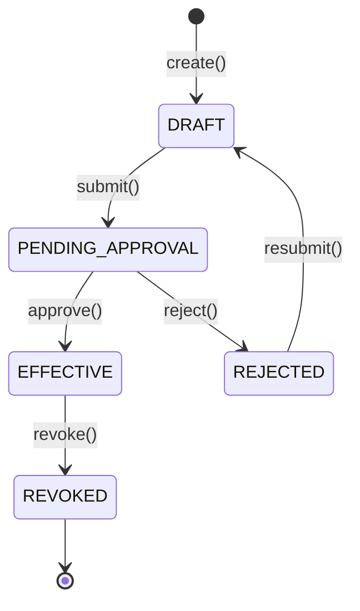

### 4.3 来自角色模板的虚拟 Grant

`EffectivePermissionService.resolveLiveRoleTemplateGrants()` 在权限检查时动态将有效的身份委派转换为"虚拟 Grant":

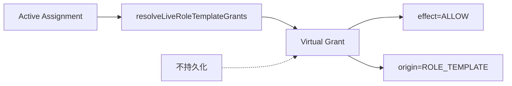

- 不持久化，每次权限检查时实时计算
- 与持久化 Grant 通过相同的 ScopeMatcher + EffectResolver 管线合并

---

## 五、权限检查引擎

### 5.1 两层 AND 权限检查

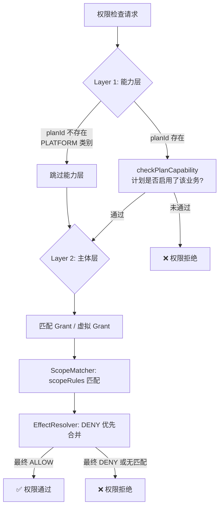

### 5.2 EffectResolver: DENY 优先合并

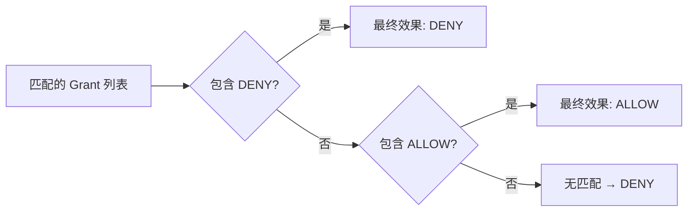

**关键特性**: 紧急撤销时添加一条 DENY Grant，立即覆盖所有 ROLE_TEMPLATE 的 ALLOW，无需等待缓存过期。

### 5.3 权限类别

| 类别 | 需要 planId | 能力层 | 主体层作用域 |
|------|-----------|--------|------------|
| BUSINESS | 是 | 计划是否启用该业务 | PLAN/CUSTOMER/GLOBAL 均可 |
| PLATFORM | 否 | 跳过 | 仅 GLOBAL 匹配 |

---

## 六、权限-菜单-按钮关联

### 6.1 PermissionItem 自动注册

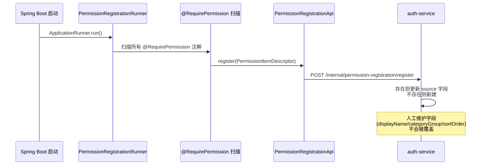

- **源字段**（自动覆盖）: controller, method, httpMethod, path
- **人工字段**（不覆盖）: displayName, categoryGroup, sortOrder
- **失败策略**: fail-soft，仅 WARN 日志，不阻断启动

### 6.2 菜单树与权限绑定

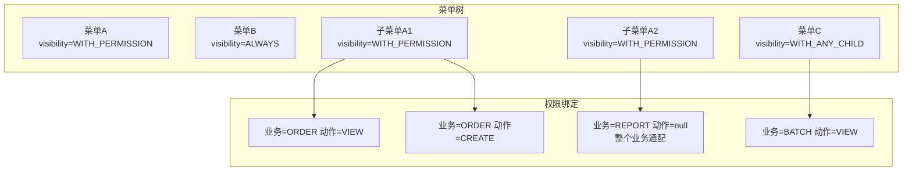

**可见性规则**:
- `ALWAYS`: 始终可见（如首页、帮助）
- `WITH_PERMISSION`: 用户拥有任一绑定权限时可见
- `WITH_ANY_CHILD`: 任一子菜单可见时父菜单可见

**绑定语义**: OR — 一个菜单绑定多个 PermissionBinding 时，用户拥有任一权限即满足

### 6.3 MenuTreeAssembler

纯函数，无 Spring 依赖:
1. 按 parentId 分组
2. 按 sortOrder 排序
3. 递归过滤: 根据用户的 `Set<Permission>` 逐层判断可见性
4. 输出: 仅含可见节点的树形结构

### 6.4 SessionPermissionCache

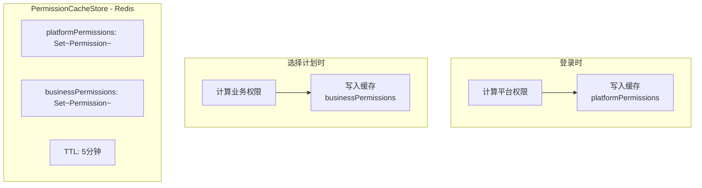

**关键区分**:
- 前端菜单/按钮可见性: 使用缓存（最终一致）
- 后端 API 鉴权: 实时查询 Grant（强一致）

---

## 七、登录登出与会话管理

### 7.1 Session 聚合根

```
Session (存储在 Redis，不落库)
├── sessionId: SessionId         # = Sa-Token tokenValue
├── accountId: UserNo
├── channel: AnnuityChannel      # INTERNET | HQ | BRANCH
├── effectiveIdentity: EffectiveIdentity
│   ├── identityAccountId: UserNo   # 用于权限判定
│   ├── actingAccountId: UserNo     # 用于审计追踪
│   └── viaSecondaryAuth: boolean   # 是否经过二次授权
├── selectedPlanId: PlanId       # 当前选中的计划
├── permissionCache: SessionPermissionCache
├── openedAt: LocalDateTime
└── expiresAt: LocalDateTime
```

`EffectiveIdentity` 的关键设计: 二次授权场景下，`identityAccountId`（授权人）用于权限判定，`actingAccountId`（操作人）用于审计追踪。

### 7.2 登录流程

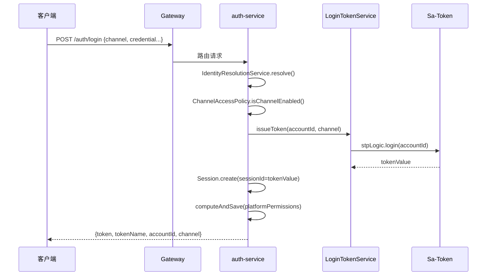

### 7.3 渠道隔离机制

每个渠道（INTERNET/HQ/BRANCH）拥有独立的 `StpLogic` 实例，使用不同的 `tokenName`:

| 渠道 | tokenName | Header |
|------|-----------|--------|
| INTERNET | satoken-internet | satoken-internet |
| HQ | satoken-hq | satoken-hq |
| BRANCH | satoken-branch | satoken-branch |

- 仅 Header 传递 token，禁用 Cookie 防 CSRF
- 同一用户可同时在不同渠道登录，互不干扰

### 7.4 Gateway 认证流程

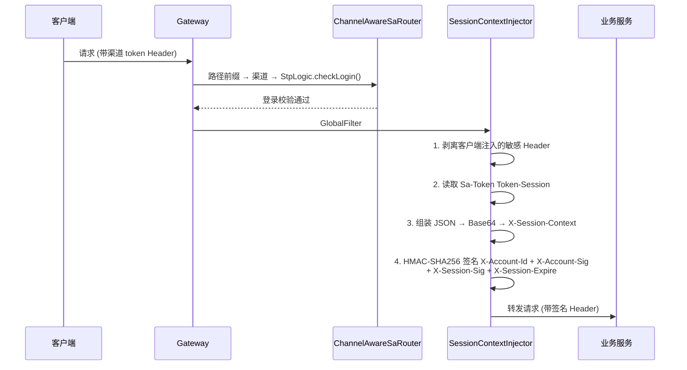

**安全要点**:
- Gateway 不做细粒度权限检查（`getPermissionList()` 返回空列表）
- 仅负责认证（是否登录）和会话上下文注入
- HMAC 签名防止客户端伪造请求头

### 7.5 登出流程

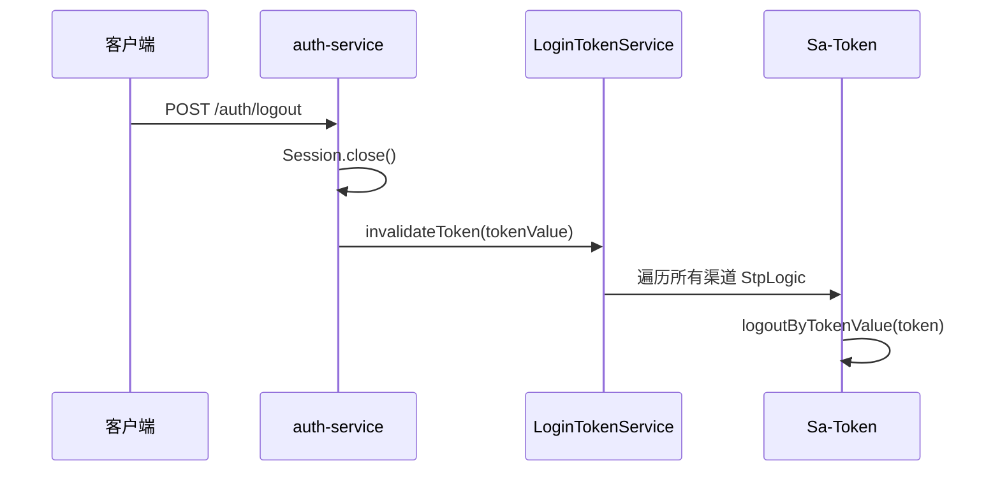

---

## 八、接口权限管控

### 8.1 @RequirePermission AOP

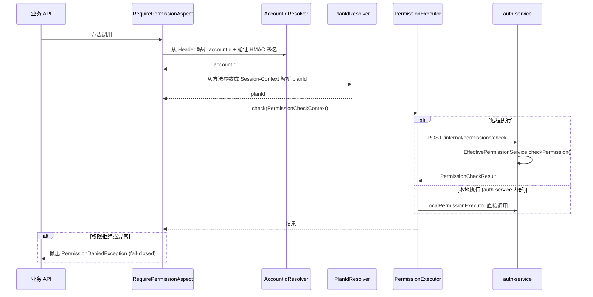

**fail-closed 原则**: 任何异常（网络超时、服务不可用）均视为权限拒绝，防止权限检查失效导致越权访问。

### 8.2 @DataScope 行级数据过滤

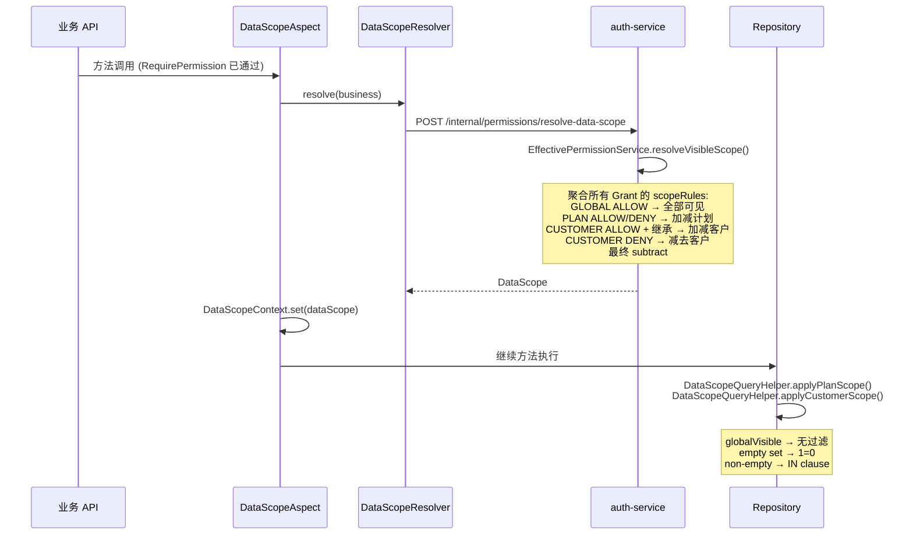

### 8.3 Gateway 与业务服务的权限分工

| 层级 | 职责 | 检查粒度 |
|------|------|---------|
| Gateway | 认证（是否登录）+ 会话上下文签名注入 | 粗粒度 |
| 业务服务 @RequirePermission | 能力层 + 主体层权限检查 | 细粒度 (business+action) |
| 业务服务 @DataScope | 行级数据范围过滤 | 行级 (plan/customer) |

---

## 九、网点二次授权

### 9.1 流程概览

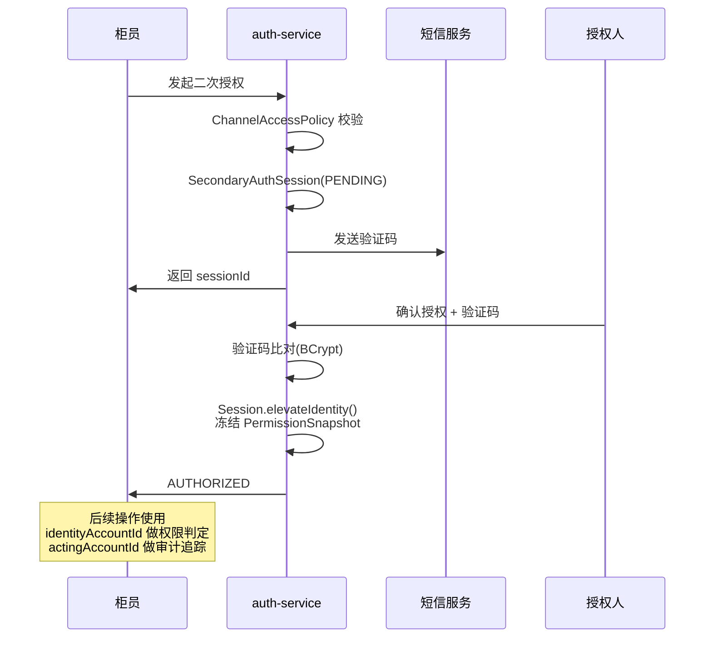

### 9.2 SecondaryAuthSession 状态机

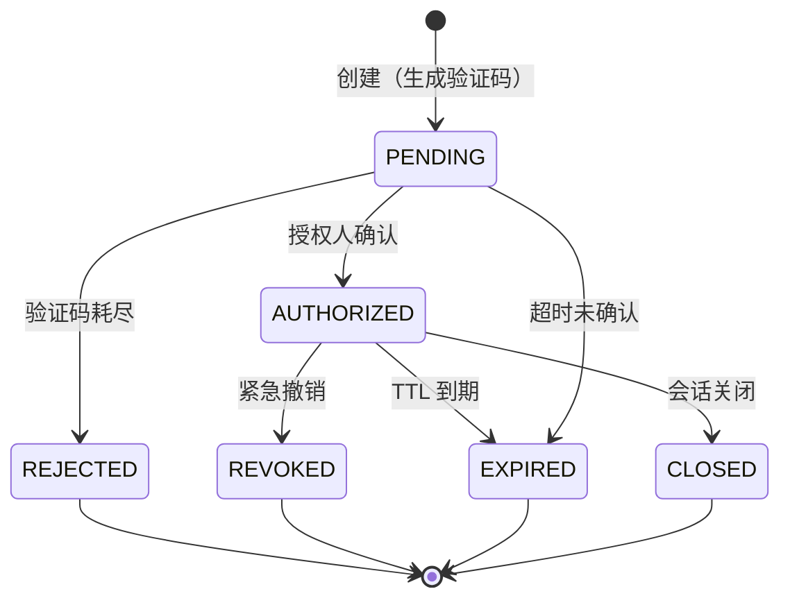

**PermissionSnapshot**: 授权时刻冻结的权限集，带 TTL。过期后需重新二次授权。

---

## 十、完整请求链路总览

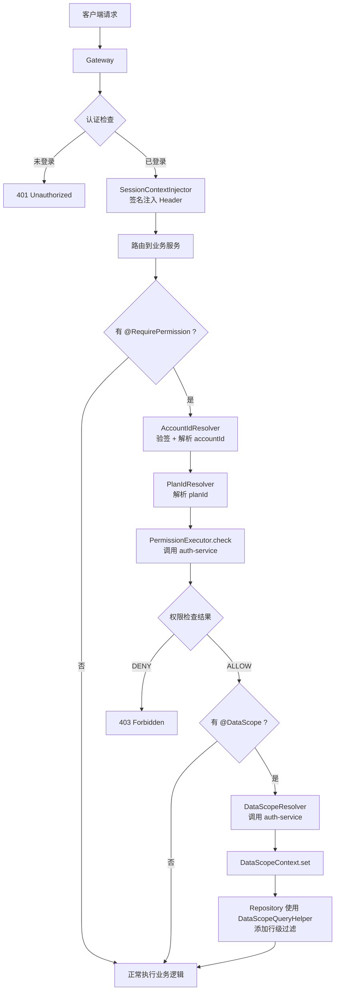

---

## 十一、数据库表结构

| 表名 | 用途 | 关键字段 |
|------|------|---------|
| t_auth_user | 用户基本信息 | user_no, user_type, user_status, identity_document(JSONB), contact_info(JSONB) |
| t_auth_credential | 登录凭证 | owner_type, owner_id, credential_type, credential_data(JSONB), enabled_channels(JSONB) |
| t_auth_role_template | 角色模板 | role_code, scope_dimension, scope_value, permissions(JSONB) |
| t_auth_role_visibility | 角色可见性 | role_code, customer_no, visibility_mode |
| t_auth_assignment | 身份委派 | user_no, role_code, scope_dimension, scope_value, inheritable, status |
| t_auth_grant | 授权策略 | subject(JSONB), scope_rules(JSONB), permissions(JSONB), grant_type, origin, effect, status, validity_period |
| t_auth_permission_item | 权限元数据 | business_code, action_code, category, controller, method, http_method, path |
| t_auth_permission_menu | 菜单树 | parent_id, menu_code, visibility, sort_order |
| t_auth_menu_permission_binding | 菜单权限绑定 | menu_id, business_code, action_code |
| t_auth_customer_channel_entitlement | 客户渠道权限 | customer_no, enabled_channels(JSONB) |
| t_auth_secondary_auth_session | 二次授权会话 | session_id, teller_id, approver_id, verification_code_hash, status, permission_snapshot(JSONB) |

**JSONB 字段说明**:
- PostgreSQL JSONB 类型用于存储复杂嵌套结构（身份证件、凭证数据、权限集、作用域规则等）
- 查询时可用 PostgreSQL JSONB 操作符做索引查询
- MySQL 方案中使用 JSON 类型替代

---

## 十二、核心设计总结

### 12.1 权限模型三层架构

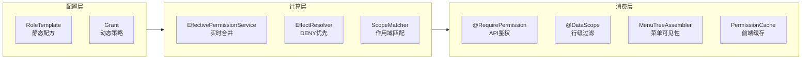

### 12.2 一致性保证

| 维度 | 机制 | 一致性级别 |
|------|------|-----------|
| API 鉴权 | 实时查询 Grant + 虚拟 Grant | 强一致 |
| 行级过滤 | 实时查询 resolveVisibleScope | 强一致 |
| 前端菜单/按钮 | SessionPermissionCache (5min TTL) | 最终一致 |
| 紧急撤销 | 添加 DENY Grant → 立即覆盖所有 ALLOW | 强一致 |
| 冻结踢出 | 事务外 invalidateAllTokensOf → 允许失败 | 最终一致（依赖 TTL） |

### 12.3 安全设计要点

1. **Gateway 不做权限检查** — 仅认证 + 签名注入，细粒度权限下沉到业务服务
2. **HMAC 签名** — 防止客户端伪造 X-Account-Id 等敏感 Header
3. **fail-closed** — 权限检查异常时拒绝访问，宁可误杀不可漏放
4. **渠道隔离** — 独立 StpLogic + 独立 tokenName，防止跨渠道 token 复用
5. **二次授权快照** — 授权时刻冻结权限，防止授权后权限变更导致越权
6. **DENY 优先** — 紧急撤销添加 DENY Grant 立即生效，无需等待缓存过期
