# 业务办理数据处理流程

> 本文档详细分析从用户发起业务办理到数据落库的完整数据流转路径，重点覆盖表单文件上传/解析/生成、异步事件驱动流程编排、以及外部服务调用等核心场景。

---

## 一、总体请求链路

```mermaid
flowchart TD
    A[前端 SPA] -->|HTTPS + 渠道 Token| B[Internet/HQ Gateway]
    B -->|Sa-Token checkLogin<br/>SessionContextInjector 签名注入| C[BFF 层]
    C -->|@HttpExchange 代理<br/>businessType 策略路由| D[业务微服务]
    D -->|SPI / Gateway 防腐层| E[文件服务 / 审批服务 / 集成服务]
    D -->|EventBus → MQ| F[事件驱动流程推进]
    E -->|RocketMQ 回调 / 集成事件| F
```

| 层级 | 职责 | 关键组件 |
|------|------|---------|
| Gateway | 认证 + 会话签名注入 | SaReactorFilter, ChannelAwareSaRouter, SessionContextInjector |
| BFF | 路由 + 聚合 + 适配 | BffBusinessService, BffAggregationService, ScenarioHandlerRegistry |
| 业务服务 | 流程编排 + 领域逻辑 | FlowOrchestrationService, StepPipelineExecutor, AppService |
| 文件服务 | 上传/解析/生成 | FileTaskApi, FileAccessApi, TemplateConfigApi |
| 审批服务 | 审批流匹配与实例管理 | ApprovalFlowApi, ApprovalInstanceApi |
| 集成服务 | 外部交易接口调用 | BaseTradeGateway, TradeQueryClient, @TradeCode |

---

## 二、BFF 层策略路由与聚合

### 2.1 策略模式框架

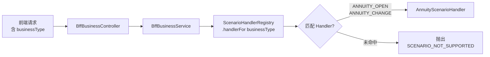

- **BffBusinessService**: 纯委托，6 个简单 CRUD 转发方法
- **BffAggregationService**: 聚合查询专用，仅 batchOverview 1 个方法
- **ScenarioHandlerRegistry**: 启动时扫描所有 BusinessScenarioHandler Bean，按 supportedTypes() 构建路由表

### 2.2 AnnuityScenarioHandler 并发聚合

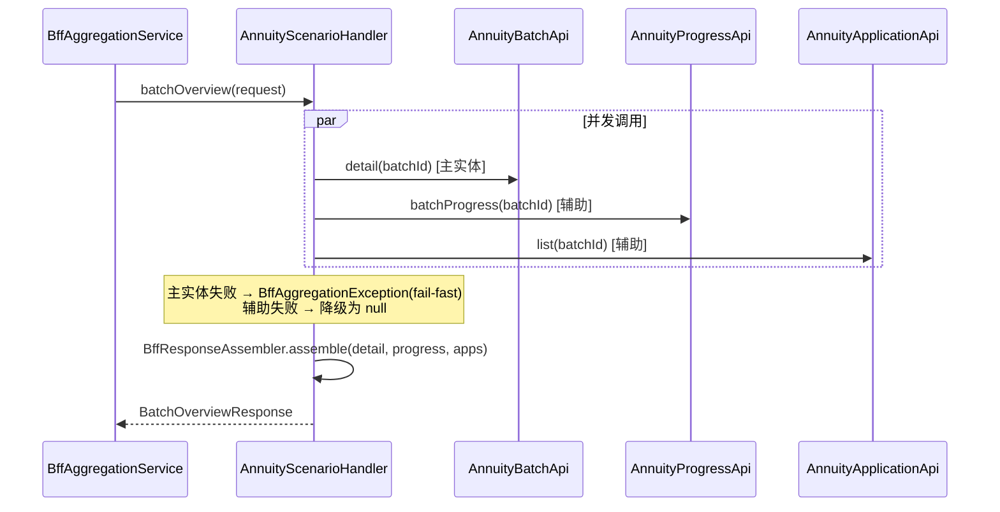

**降级语义**:
- 主实体(batch detail)失败 → 整个请求失败
- 辅助 API(progress/applications)失败 → 降级，主数据仍正常返回

---

## 三、表单文件上传场景

### 3.1 完整上传流程

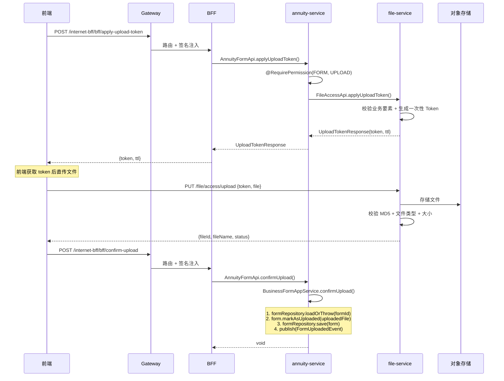

### 3.2 上传 Token 安全机制

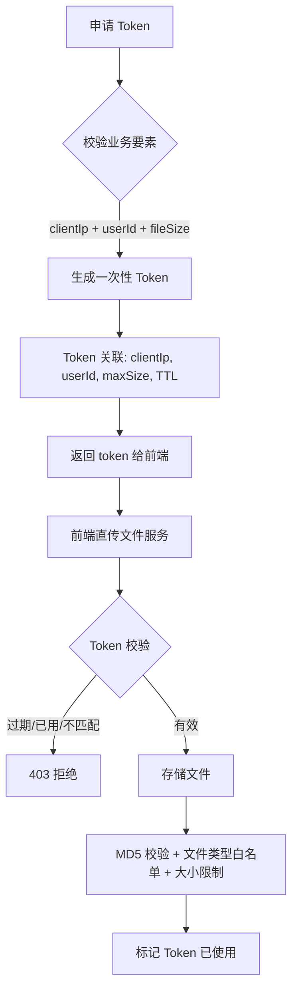

**关键安全点**:
- 文件流不经过业务服务，前端直传文件服务，降低业务服务负载
- Token 一次性使用，防止重放
- MD5 校验防止传输损坏
- 文件类型白名单 + 大小限制防止恶意上传

---

## 四、表单解析场景（异步事件驱动）

### 4.1 三阶段解析编排

```mermaid
flowchart TD
    subgraph Phase1["阶段1: 确认上传"]
        A[confirmUpload] --> B[form.markAsUploaded]
        B --> C[publish FormUploadedEvent]
    end

    subgraph Phase2["阶段2: 触发解析"]
        D[FormUploadedEventListener<br/>@TransactionalEventListener AFTER_COMMIT] --> E[triggerParsing]
        E --> F[configGateway.getFormParsingConfig]
        F --> G[fileIntegrationGateway.triggerAsyncParsing]
        G --> H[form.markAsParsing]
    end

    subgraph Phase3["阶段3: 处理解析结果"]
        I[FileParsedEventDTO<br/>来自 RocketMQ] --> J[FileParsedEventListener]
        J --> K[handleParsingResult]
        K --> L[form.markAsParsed]
        L --> M[裂变: BusinessApplication.createFromForm]
        M --> N[publish ApplicationSpawnedEvent]
    end

    C -.->D
    G -.->|file-service 回调| I
```

### 4.2 表单裂变为申请单

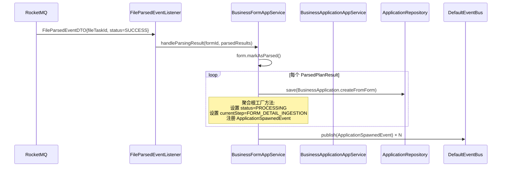

### 4.3 演示环境 Mock 机制

```mermaid
flowchart LR
    A[triggerAsyncParsing] --> B{运行环境?}
    B -->|生产| C[FileServiceIntegrationGateway<br/>调用 file-service API]
    B -->|演示| D[MockFileIntegrationGateway<br/>@Primary 覆盖]
    D --> E[IntegrationEventSimulator<br/>.publish(FileParsedEventDTO)]
    E --> F[Spring EventListener<br/>驱动 FileParsedEventListener]
    F --> G[立即推进流程]
```

Mock 网关通过 @Primary 覆盖 kernel 的默认实现，立即发布 FileParsedEventDTO，模拟 file-service 解析完成回调。

---

## 五、流程引擎编排场景

### 5.1 FlowOrchestrationService 核心编排

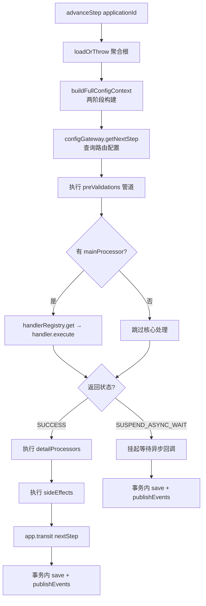

### 5.2 两阶段配置上下文构建

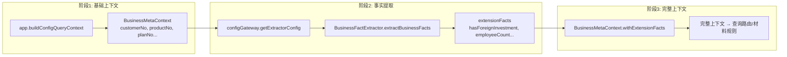

**为什么需要两阶段?** 因为提取器配置本身需要基础上下文来查询，而提取出的事实又会影响后续路由和材料规则的匹配。

### 5.3 年金流程步骤配置

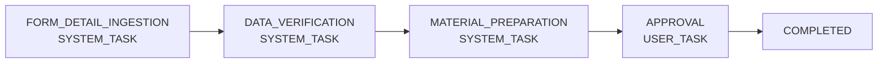

| 步骤 | 类型 | mainProcessor | detailProcessors | preValidations |
|------|------|--------------|-----------------|---------------|
| FORM_DETAIL_INGESTION | SYSTEM | null | annuityDetailIngestionAction | annuityAuditLogAction |
| DATA_VERIFICATION | SYSTEM | annuityDataVerificationHandler | annuityCustomerProfileEnrichmentAction | annuityAuditLogAction + 2个VALIDATION |
| MATERIAL_PREPARATION | SYSTEM | planMaterialPreparationHandler | annuityEmployeeMaterialAction | annuityAuditLogAction |
| APPROVAL | USER | null | — | annuityAuditLogAction |

### 5.4 自动推进与挂起机制

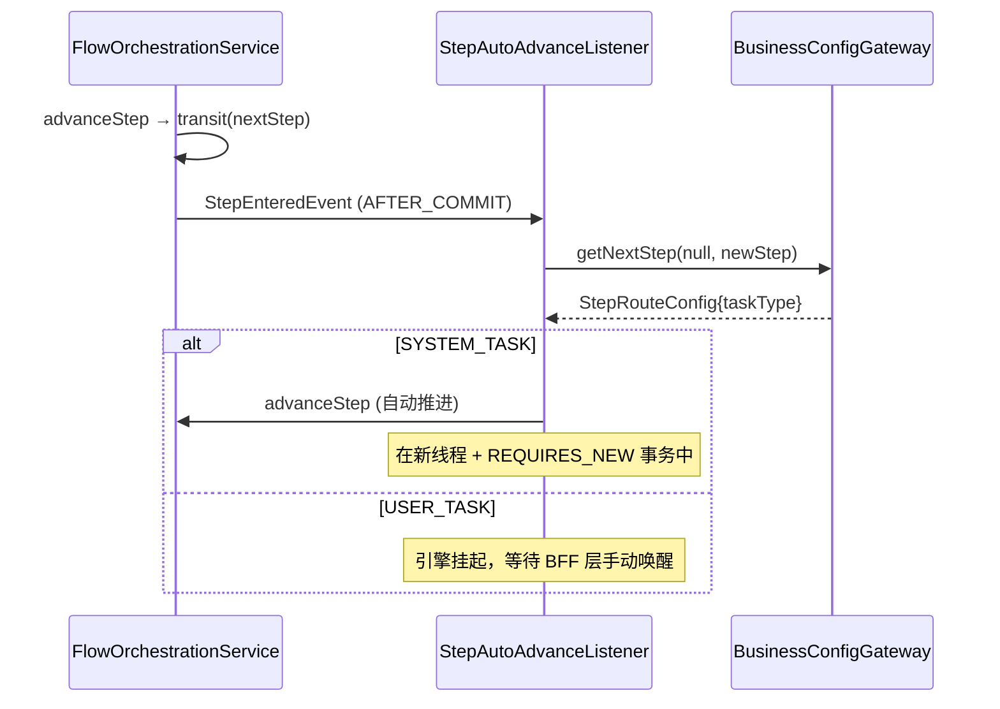

---

## 六、明细数据流式摄入场景

### 6.1 AbstractJsonStreamIngestionAction 模板方法

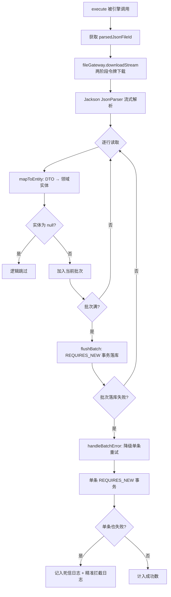

### 6.2 三级异常隔离

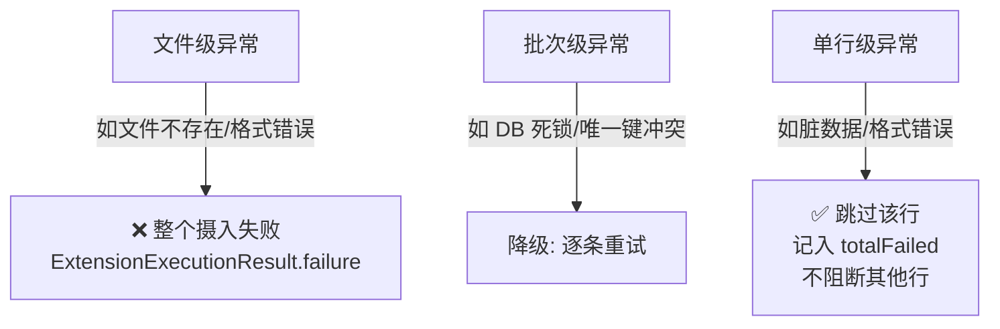

### 6.3 管道流下载桥接

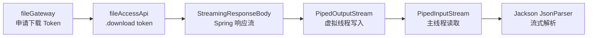

**为什么用管道流?** file-service 返回 StreamingResponseBody（向 OutputStream 写），而 Jackson JsonParser 需要从 InputStream 读。通过 PipedStream 管道对 + 虚拟线程桥接，实现零拷贝流式处理，避免将整个文件加载到内存。

### 6.4 年金具体实现

```
AnnuityDetailIngestionAction extends AbstractJsonStreamIngestionAction<AnnuityEmployeeDTO, AnnuityEmployeeDetail>
├── mapToEntity: employeeMapper.mapToEntity(dto, appId, rowIndex)
├── saveBatch: batchRepository.findByApplicationId → batch.addDetail → batchRepository.save
├── extractTraceId: entity.idCardNo()  ← 身份证号精准追踪
└── getBatchSize: 100  ← 年金场景批次更小
```

---

## 七、材料计算场景

### 7.1 双层材料计算

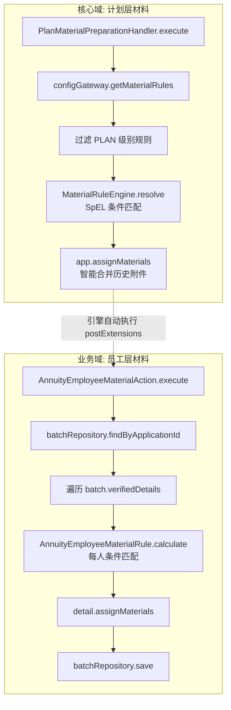

**核心域-业务域解耦**: kernel 的 PlanMaterialPreparationHandler 只处理计划层规则，业务特有的明细层材料通过 postExtensions 扩展点注入。

### 7.2 材料清单智能合并

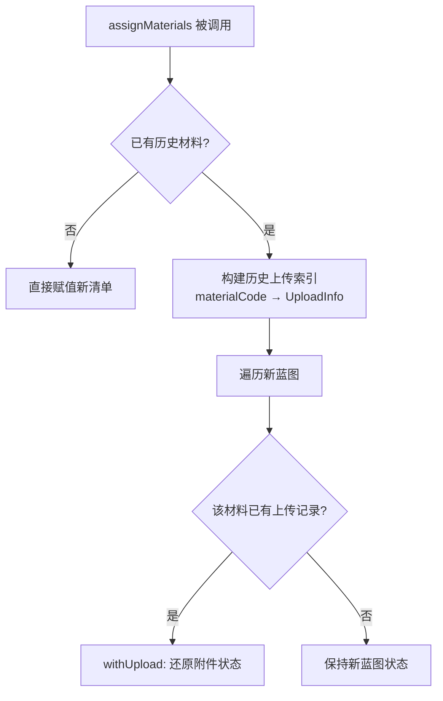

---

## 八、审批场景

### 8.1 审批发起与回调

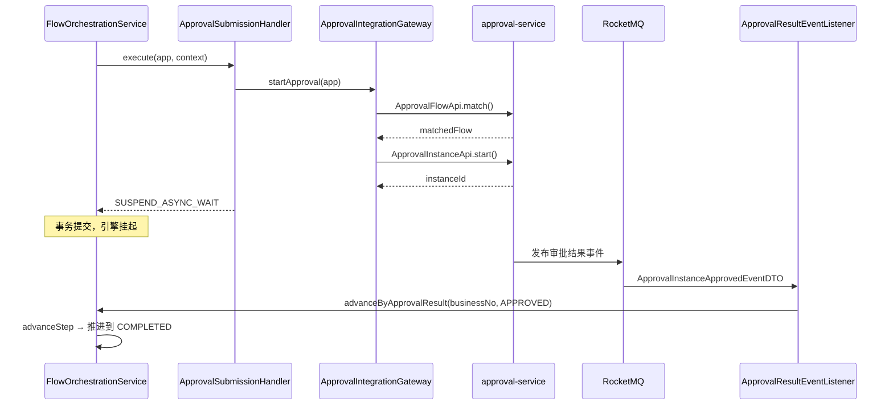

### 8.2 审批结果驱动的状态流转

| 审批结果 | 业务申请单状态 | 流程动作 |
|---------|-------------|---------|
| APPROVED | — | advanceStep → 推进到下一节点 |
| REJECTED | REJECTED (终态) | reject() |
| WITHDRAWN | WITHDRAWN (终态) | withdraw() |

---

## 九、外部服务调用场景

### 9.1 集成服务调用架构

```mermaid
flowchart TD
    subgraph Domain["集成服务领域层"]
        A[TradeGateway SPI] --> B[TradeQueryGateway SPI]
    end

    subgraph Infra["集成服务基础设施层"]
        C[BaseTradeGateway<br/>extends BaseGateway] --> D[performTradeCall 模板方法]
        D --> E[TradeQueryClient<br/>Retrofit HTTP 客户端]
        D --> F[@TradeCode 注解<br/>自动提取交易码]
        D --> G[TradeReqHead<br/>标准化报文头]
    end

    subgraph External["外部核心系统"]
        E -->|HTTPS + 标准报文| H[5564 企业年金组合查询<br/>...其他交易码]
    end

    A -.->|实现| C
```

### 9.2 BaseTradeGateway 调用流程

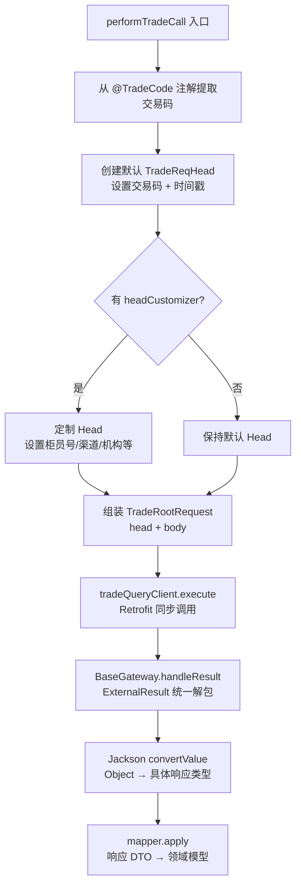

### 9.3 BaseGateway 统一错误处理

```mermaid
flowchart TD
    A[handleResult] --> B{result == null?}
    B -->|是| C[抛 SystemException<br/>REMOTE_SERVICE_ERROR]
    B -->|否| D{result.isSuccess?}
    D -->|否| E[抛 SystemException<br/>记录错误码 + 消息]
    D -->|是| F[返回 data]
```

**调用模式对比**:

| 模式 | 适用场景 | 典型实现 |
|------|---------|---------|
| ExternalResult 包装 | 银行核心等有标准返回包装 | BaseGateway.perform() |
| 直连模式 | REST API 无标准包装 | BaseGateway.performDirect() |
| Object 原始模式 | 核心交易返回嵌套泛型 | BaseGateway.performRaw() → BaseTradeGateway |

---

## 十、文件生成场景（导出/PDF）

### 10.1 文件下载流程

```mermaid
sequenceDiagram
    participant FE as 前端
    participant GW as Gateway
    participant BFF as BFF
    participant SVC as 业务服务
    participant FS as file-service

    FE->>GW: POST /bff/apply-download-token
    GW->>BFF: 路由
    BFF->>SVC: MaterialApi.applyDownloadToken()
    SVC->>FS: FileAccessApi.applyDownloadToken()
    Note over FS: 校验: fileId + sourceApp<br/>+ customerNo/productNo 一致性
    FS-->>SVC: token + ttl
    SVC-->>FE: {token, ttl}

    FE->>FS: GET /file/access/download?token=xxx
    FS->>FS: 校验 Token 有效性 + 一致性
    FS->>FS: 读取文件 → StreamingResponseBody
    FS-->>FE: 文件流 (chunked transfer)
```

### 10.2 文件服务 API 分层

| API | 职责 | 典型端点 |
|-----|------|---------|
| FileTaskApi | 上传/解析任务管理 | upload, getTask, listSubTasks, cancel |
| FileAccessApi | 文件存取令牌 + 下载 | applyUploadToken, applyDownloadToken, download |
| ParsedDataApi | 解析后数据查询 | fetchRows (分页拉取) |
| TemplateConfigApi | 解析模板配置 | save, get, activate |

---

## 十一、完整业务办理端到端流程

```mermaid
sequenceDiagram
    participant FE as 前端
    participant GW as Gateway
    participant BFF as BFF
    participant SVC as annuity-service
    participant Kernel as business-core-kernel
    participant FS as file-service
    participant Approval as approval-service
    participant MQ as RocketMQ
    participant Integration as integration-service

    rect rgb(230, 245, 255)
        Note over FE,FS: 阶段1: 创建批次 + 上传表单
        FE->>GW: createBatch{businessType, planNo}
        GW->>BFF: 路由
        BFF->>SVC: AnnuityBatchApi.create()
        SVC->>Kernel: BusinessBatchAppService.createBatch()
        Kernel-->>FE: {batchId}

        FE->>GW: applyUploadToken{batchId, fileName}
        GW->>BFF: 路由
        BFF->>SVC: AnnuityFormApi.applyUploadToken()
        SVC->>FS: FileAccessApi.applyUploadToken()
        FS-->>FE: {token}

        FE->>FS: 直传文件
        FS-->>FE: {fileId}

        FE->>GW: confirmUpload{formId, fileId}
        GW->>BFF: 路由
        BFF->>SVC: AnnuityFormApi.confirmUpload()
        SVC->>Kernel: BusinessFormAppService.confirmUpload()
        Note over Kernel: form.markAsUploaded → publish FormUploadedEvent
    end

    rect rgb(255, 245, 230)
        Note over Kernel,FS: 阶段2: 异步解析 → 裂变
        Kernel->>Kernel: FormUploadedEventListener (AFTER_COMMIT)
        Kernel->>FS: triggerAsyncParsing{formId, fileId, templateId}
        FS->>FS: 解析 Excel → 拆分 JSON
        FS->>MQ: FileParsedEventDTO
        MQ->>Kernel: FileParsedEventListener
        Note over Kernel: form.markAsParsed<br/>裂变 N 个 BusinessApplication<br/>publish ApplicationSpawnedEvent × N
    end

    rect rgb(230, 255, 230)
        Note over Kernel: 阶段3: 明细摄入 (SYSTEM_TASK 自动推进)
        Kernel->>Kernel: ApplicationSpawnedListener (AFTER_COMMIT, @Async)
        Kernel->>Kernel: advanceStep → FORM_DETAIL_INGESTION
        Note over Kernel: StepAutoAdvanceListener 判断 SYSTEM_TASK → 自动推进
        Kernel->>Kernel: preValidation: annuityAuditLogAction
        Kernel->>Kernel: detailProcessor: annuityDetailIngestionAction<br/>FS.downloadStream → Jackson 流式解析<br/>REQUIRES_NEW 批次落库
        Kernel->>Kernel: sideEffect: annuityEmployeeCountValidationAction
        Kernel->>Kernel: transit → DATA_VERIFICATION
    end

    rect rgb(245, 230, 255)
        Note over Kernel,Integration: 阶段4: 数据核查 (SYSTEM_TASK 自动推进)
        Kernel->>Kernel: StepAutoAdvanceListener → 自动推进
        Kernel->>Kernel: preValidations: auditLog + contributionValidation + foreignInvestmentValidation
        Kernel->>Kernel: mainProcessor: annuityDataVerificationHandler
        Note over Kernel: handler 内部可能调用 Integration 查外部数据
        Kernel->>Kernel: detailProcessor: annuityCustomerProfileEnrichmentAction
        Kernel->>Kernel: transit → MATERIAL_PREPARATION
    end

    rect rgb(255, 255, 230)
        Note over Kernel: 阶段5: 材料准备 (SYSTEM_TASK 自动推进)
        Kernel->>Kernel: StepAutoAdvanceListener → 自动推进
        Kernel->>Kernel: mainProcessor: planMaterialPreparationHandler<br/>计算计划层材料清单
        Kernel->>Kernel: detailProcessor: annuityEmployeeMaterialAction<br/>计算每人材料清单
        Kernel->>Kernel: transit → APPROVAL
    end

    rect rgb(255, 230, 230)
        Note over FE,Approval: 阶段6: 审批 (USER_TASK 挂起)
        Kernel->>Kernel: StepAutoAdvanceListener → USER_TASK, 挂起
        Note over FE: 前端展示材料清单，用户上传补充材料
        FE->>GW: submitApplication{applicationId}
        GW->>BFF: 路由
        BFF->>SVC: AnnuityApplicationApi.submit()
        SVC->>Kernel: advanceStep → APPROVAL
        Note over Kernel: preValidation: annuityAuditLogAction<br/>sideEffect: annuityMaterialPreparedNotificationAction (异步通知)<br/>mainProcessor: null (无核心处理)
        Note over Kernel: 若路由配置了 approvalSubmissionHandler<br/>则 mainProcessor 调用 ApprovalIntegrationGateway.startApproval()
        Kernel-->>Approval: startApproval → 审批实例创建
        Approval->>MQ: ApprovalInstanceApprovedEventDTO
        MQ->>Kernel: ApprovalResultEventListener
        Kernel->>Kernel: advanceByApprovalResult → APPROVED
        Kernel->>Kernel: transit → COMPLETED
    end
```

---

## 十二、数据流转路径汇总

```mermaid
flowchart TD
    subgraph Upload["上传路径"]
        U1[前端] -->|Token| U2[file-service]
        U1 -->|直传文件| U2
        U2 -->|fileId| U3[业务服务 confirmUpload]
    end

    subgraph Parse["解析路径"]
        P1[FormUploadedEvent] -->|AFTER_COMMIT| P2[triggerAsyncParsing]
        P2 -->|FileTaskApi| P3[file-service]
        P3 -->|RocketMQ| P4[FileParsedEventDTO]
        P4 --> P5[handleParsingResult]
        P5 --> P6[裂变 Application × N]
    end

    subgraph Ingest["摄入路径"]
        I1[ApplicationSpawnedEvent] -->|AFTER_COMMIT + @Async| I2[advanceStep FORM_DETAIL_INGESTION]
        I2 --> I3[annuityDetailIngestionAction]
        I3 -->|FileAccessApi.download| I4[StreamingResponseBody]
        I4 -->|PipedStream 桥接| I5[Jackson JsonParser]
        I5 -->|mapToEntity + REQUIRES_NEW| I6[batchRepository.save]
    end

    subgraph Verify["核查路径"]
        V1[StepAutoAdvance SYSTEM_TASK] --> V2[advanceStep DATA_VERIFICATION]
        V2 --> V3[annuityDataVerificationHandler]
        V3 -->|可能调用| V4[integration-service]
        V4 -->|BaseTradeGateway| V5[外部核心系统]
    end

    subgraph Material["材料路径"]
        M1[StepAutoAdvance SYSTEM_TASK] --> M2[advanceStep MATERIAL_PREPARATION]
        M2 --> M3[planMaterialPreparationHandler]
        M3 --> M4[annuityEmployeeMaterialAction]
    end

    subgraph Approve["审批路径"]
        A1[用户手动提交] --> A2[advanceStep APPROVAL]
        A2 --> A3[approvalSubmissionHandler]
        A3 -->|ApprovalInstanceApi| A4[approval-service]
        A4 -->|RocketMQ| A5[审批结果事件]
        A5 --> A6[advanceByApprovalResult]
    end
```

---

## 十三、关键技术决策

| 决策 | 理由 | 影响 |
|------|------|------|
| 文件上传走 Token 直传 | 避免大文件流经业务服务，降低内存和带宽压力 | 需要两步操作（申请 Token → 直传），增加前端复杂度 |
| 文件解析走异步回调 | Excel 解析耗时且不可控，不能阻塞请求线程 | 需要事件驱动机制保证最终一致性 |
| 明细摄入走流式 + 管道流 | 千万级明细数据不能全量加载到内存 | 需要 PipedStream + 虚拟线程桥接 Spring StreamingResponseBody |
| 批次落库走 REQUIRES_NEW | 大批次写入可能死锁，不能污染外层事务 | 单批次失败不影响其他批次，但需要降级单条重试补偿 |
| 事实提取器两阶段构建 | 提取器配置查询需要基础上下文，而提取出的事实又影响后续路由 | 增加了一次额外的配置查询，但保证了规则匹配的完整性 |
| SYSTEM_TASK 自动推进 | 系统步骤无需人工干预，减少前端轮询 | 需要 @Async + REQUIRES_NEW 保证事务隔离 |
| USER_TASK 挂起 | 审批等步骤必须人工触发，不能自动推进 | 引擎挂起后由 BFF 层手动唤醒 |
| 核心域不持有业务仓储 | kernel 不感知年金明细等业务特有数据，保持通用性 | 业务逻辑通过 SPI 扩展点注入，需配置闭环 |

---

## 十四、组件职责速查

| 组件 | 层级 | 职责 |
|------|------|------|
| SessionContextInjector | Gateway | 剥离伪造 Header → 读 Token-Session → Base64 编码 → HMAC 签名 → 注入下游 |
| SessionContextResolver | Kernel Adapter | 验签 → 解码 Base64 → 反序列化 SessionContext |
| BusinessMetaContextAssembler | Kernel Adapter | 校验 planNo 一致性 → 组装完整 BusinessMetaContext |
| ScenarioHandlerRegistry | BFF Shared | 按 businessType 路由到具体 Handler |
| AnnuityScenarioHandler | BFF Shared | 年金场景：简单转发 6 方法 + 并发聚合 batchOverview |
| FlowOrchestrationService | Kernel App | 核心：load → buildContext → queryRoute → pipeline → transit → save + publish |
| StepPipelineExecutor | Kernel App | 微编排：排序 → 条件过滤 → 同步/异步分发 → 突变 → 致命/非致命处理 |
| DefaultFormParsingHandler | Kernel App | 查配置 → triggerAsyncParsing → 返回 SUSPEND_ASYNC_WAIT |
| PlanMaterialPreparationHandler | Kernel App | 查规则 → 过滤 PLAN 级 → 引擎匹配 → assignMaterials |
| ApprovalSubmissionHandler | Kernel App | matchFlow → startInstance → 返回 SUSPEND_ASYNC_WAIT |
| AbstractJsonStreamIngestionAction | Kernel App | downloadStream → 流式解析 → 单行隔离 → 批次落库 → 降级重试 |
| FileServiceIntegrationGateway | Kernel Infra | @HttpExchange 调用 file-service（默认实现，可被业务 @Primary 覆盖） |
| ApprovalServiceIntegrationGateway | Kernel Infra | @HttpExchange 调用 approval-service |
| BaseTradeGateway | Integration Infra | 组装报文头 → Retrofit 调用 → ExternalResult 解包 → Jackson 类型转换 |
| MockFileIntegrationGateway | Annuity Infra | @Primary 覆盖，IntegrationEventSimulator 立即发布 FileParsedEventDTO |
| JsonBusinessConfigGateway | Annuity Infra | @PostConstruct 从 classpath JSON 加载配置到内存缓存 |
