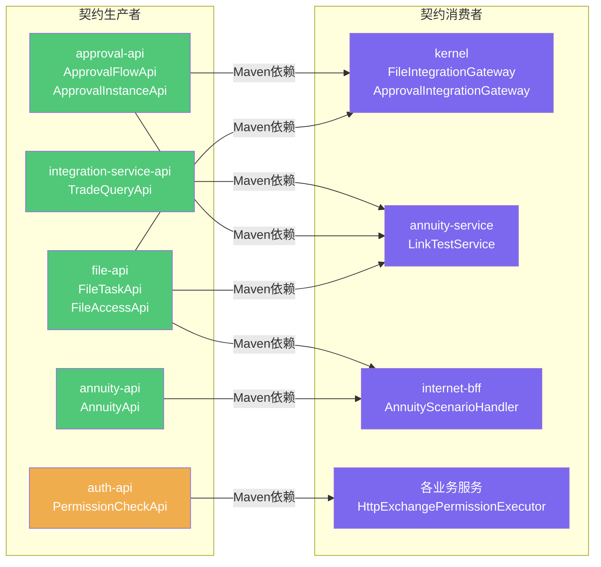
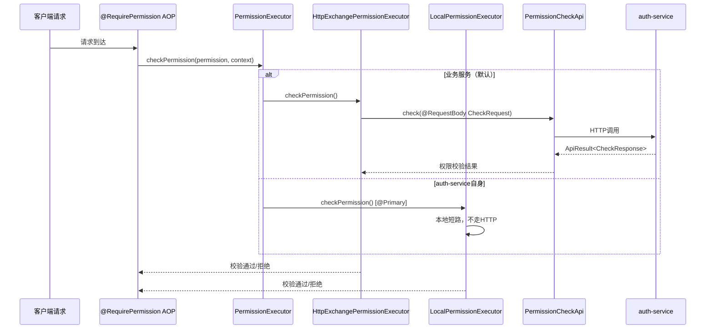
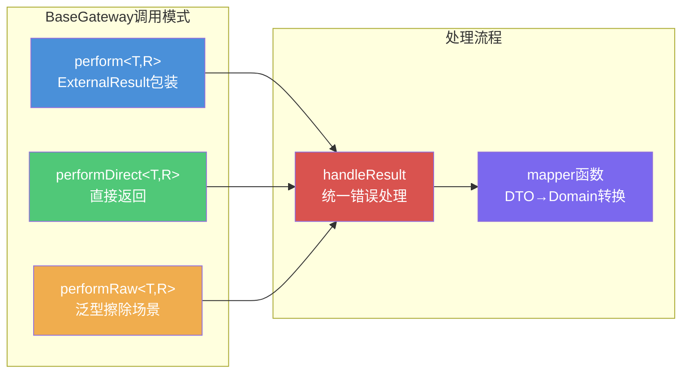
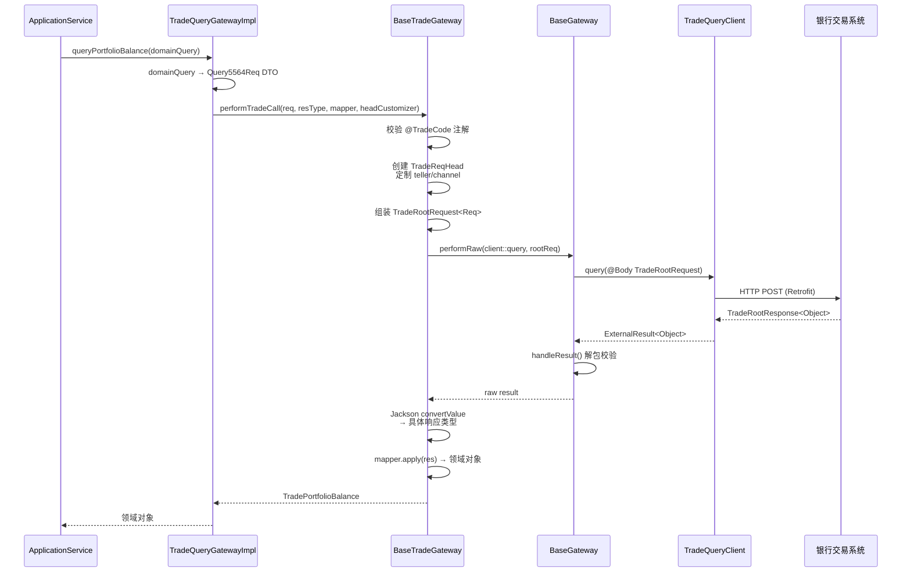
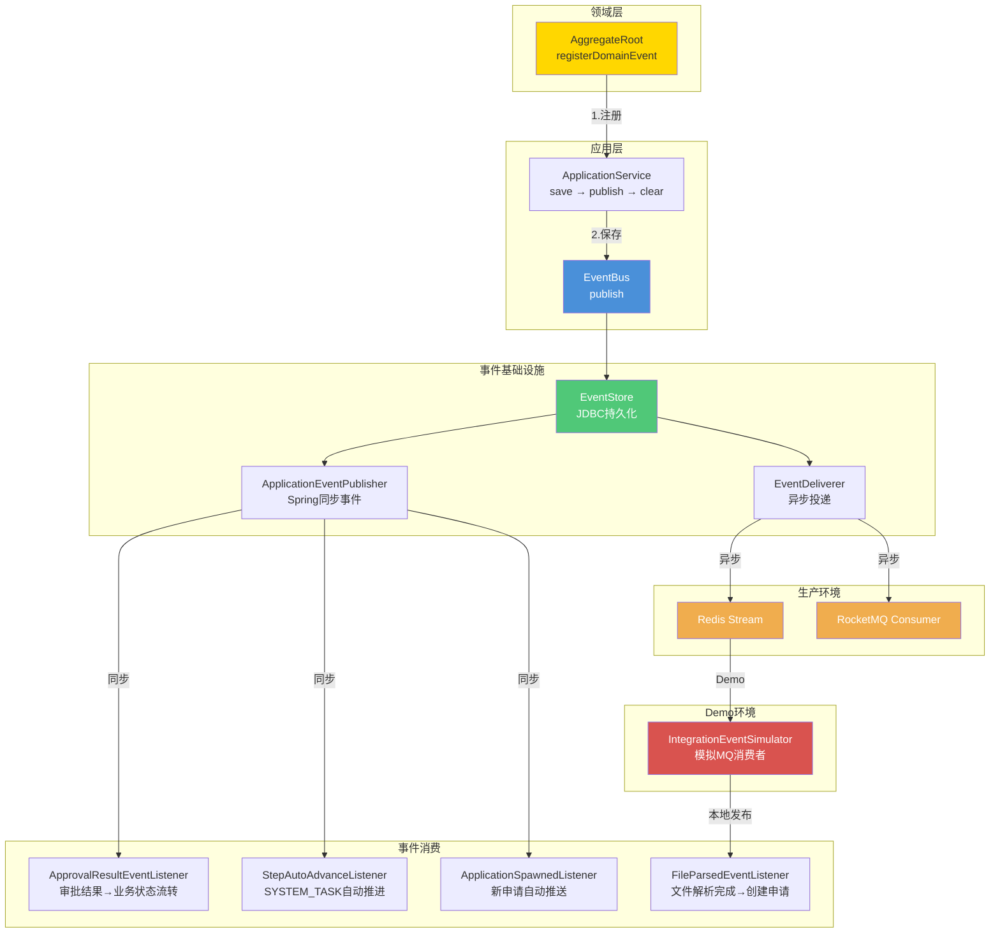
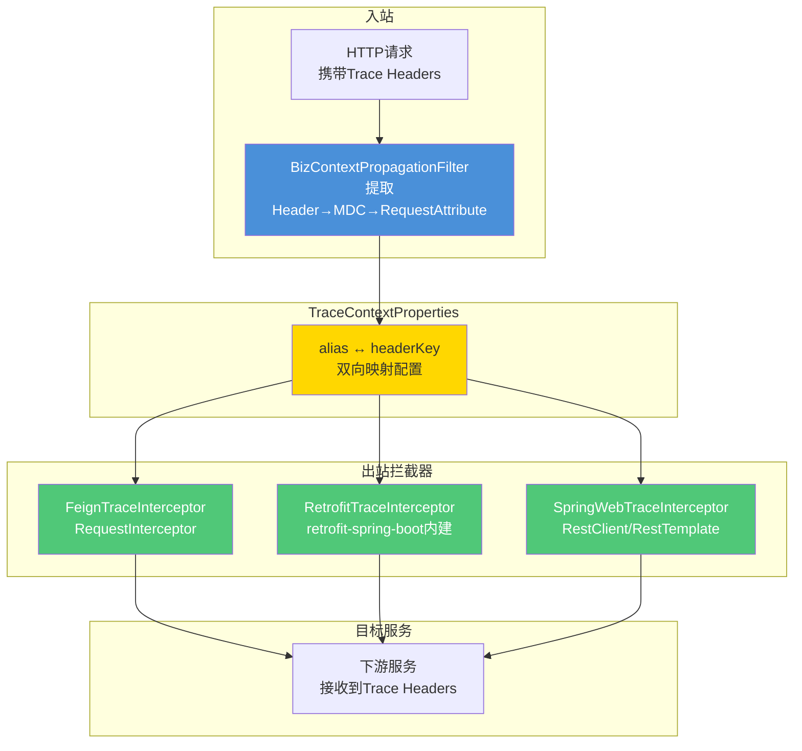

# 服务间调用与外部服务调用实现方式分析

> 本文档分析当前项目内服务间的接口调用和外部服务调用的实现方式，包括架构图和调用矩阵。

---

## 一、整体架构概览

本项目采用**双轨架构**：内部服务调用走 `@HttpExchange` 轨道，外部第三方服务调用走 `Retrofit` 轨道。

```mermaid
graph TB
    subgraph 客户端
        INTERNET[互联网用户]
        INTRANET[内网用户]
    end

    subgraph 网关层
        IG[internet-gateway<br/>认证·加密·路由]
        ING[intranet-gateway<br/>认证·路由]
    end

    subgraph BFF层
        IBFF[internet-bff<br/>聚合·适配]
        INBFF[intranet-bff<br/>聚合·适配]
    end

    subgraph 业务服务层
        AS[annuity-service]
        FS[file-service]
        APS[approval-service]
        IS[integration-service]
        KS[kernel<br/>business-core-kernel]
    end

    subgraph 基础服务层
        AUTH[auth-service]
    end

    subgraph 外部系统
        BANK[银行交易系统<br/>5564交易码]
    end

    INTERNET --> IG --> IBFF
    INTRANET --> ING --> INBFF

    IBFF -->|@HttpExchange| AS
    IBFF -->|@HttpExchange| FS
    INBFF -->|@HttpExchange| AS

    AS -->|@HttpExchange| FS
    AS -->|@HttpExchange| APS
    AS -->|@HttpExchange| IS
    AS --> KS

    KS -->|@HttpExchange| FS
    KS -->|@HttpExchange| APS

    AS & KS -.->|权限校验| AUTH

    IS -->|@RetrofitClient| BANK

    style IG fill:#4a90d9,color:#fff
    style ING fill:#4a90d9,color:#fff
    style IBFF fill:#7b68ee,color:#fff
    style INBFF fill:#7b68ee,color:#fff
    style AS fill:#50c878,color:#fff
    style FS fill:#50c878,color:#fff
    style APS fill:#50c878,color:#fff
    style IS fill:#50c878,color:#fff
    style KS fill:#50c878,color:#fff
    style AUTH fill:#f0ad4e,color:#fff
    style BANK fill:#d9534f,color:#fff
```

---

## 二、内部服务间调用 — @HttpExchange 轨道

### 2.1 契约层架构

每个服务在 `xxx-api` Maven 模块中定义 `@HttpExchange` 接口 + DTO，作为服务间调用的契约。消费者通过 Maven 依赖引入 `xxx-api` 模块。



**API 接口清单：**

| API 接口 | 路径前缀 | 所属服务 | 主要消费者 |
|----------|----------|----------|-----------|
| `FileTaskApi` | `/api/file/tasks` | file-service | kernel, annuity |
| `FileAccessApi` | `/api/file/access` | file-service | kernel |
| `ApprovalFlowApi` | `/api/approval/flows` | approval-service | kernel |
| `ApprovalInstanceApi` | `/api/approval/instances` | approval-service | kernel |
| `PermissionCheckApi` | `/internal/permissions` | auth-service | 各业务服务 |
| `TradeQueryApi` | `/api/v1/trade/portfolio` | integration-service | annuity |
| `AnnuityApi` | `/api/annuity` | annuity-service | internet-bff |

### 2.2 Kernel SPI Gateway 模式（可覆盖）

Kernel 在 domain 层定义 SPI 接口，在 infrastructure 层提供默认 `@Component` 实现，业务服务可用 `@Primary` 覆盖。

```mermaid
graph TB
    subgraph kernel-domain层
        FIG[FileIntegrationGateway<br/>《SPI接口》]
        AIG[ApprovalIntegrationGateway<br/>《SPI接口》]
    end

    subgraph kernel-infrastructure层
        FSIG[FileServiceIntegrationGateway<br/>@Component<br/>默认实现]
        ASIG[ApprovalServiceIntegrationGateway<br/>@Component<br/>默认实现]
    end

    subgraph annuity-infrastructure层
        MFIG[MockFileIntegrationGateway<br/>@Primary @Component<br/>覆盖实现]
    end

    subgraph kernel-application层
        FO[FlowOrchestrationService<br/>使用SPI接口]
        BFA[BusinessFormAppService<br/>使用SPI接口]
    end

    FIG -.->|依赖倒置| FSIG
    AIG -.->|依赖倒置| ASIG
    FIG -.->|@Primary覆盖| MFIG

    FO --> FIG
    FO --> AIG
    BFA --> FIG

    subgraph 默认实现调用链
        FSIG -->|注入| FTA[FileTaskApi<br/>@HttpExchange]
        FSIG -->|注入| FAA[FileAccessApi<br/>@HttpExchange]
        ASIG -->|注入| AFA[ApprovalFlowApi<br/>@HttpExchange]
        ASIG -->|注入| AIA[ApprovalInstanceApi<br/>@HttpExchange]
    end

    subgraph Mock实现调用链
        MFIG -->|模拟| IES[IntegrationEventSimulator<br/>本地发布集成事件]
    end

    style FIG fill:#ffd700,color:#333
    style AIG fill:#ffd700,color:#333
    style FSIG fill:#50c878,color:#fff
    style ASIG fill:#50c878,color:#fff
    style MFIG fill:#d9534f,color:#fff
    style FTA fill:#4a90d9,color:#fff
    style FAA fill:#4a90d9,color:#fff
    style AFA fill:#4a90d9,color:#fff
    style AIA fill:#4a90d9,color:#fff
```

**关键实现细节：**

- `FileServiceIntegrationGateway`：实现两阶段令牌下载、虚拟线程流式桥接（`StreamingResponseBody`→`PipedInputStream`）、上传令牌申请（含 content-type 白名单 + 大小限制 + TTL）
- `ApprovalServiceIntegrationGateway`：两步流程 — 匹配审批流 → 发起审批实例
- `MockFileIntegrationGateway`：annuity demo 环境 mock，使用 `IntegrationEventSimulator` 直接发布 `FileParsedEventDTO`，返回模拟 JSON 员工数据流

### 2.3 权限校验调用链



**条件装配逻辑：**

| Bean | 条件 | 优先级 |
|------|------|--------|
| `HttpExchangePermissionExecutor` | `@ConditionalOnBean(PermissionCheckApi.class)` + `@ConditionalOnMissingBean(PermissionExecutor.class)` | 默认 |
| `LocalPermissionExecutor` | `@Primary` + auth-service 内部使用 | 最高 |

---

## 三、外部服务调用 — Retrofit 轨道

### 3.1 外部调用基础设施

```mermaid
graph TB
    subgraph shared-client-core
        BG[BaseGateway<br/>三种调用模式<br/>统一错误处理]
        ER[ExternalResult&lt;T&gt;<br/>外部系统统一返回包装]
        SED[SimpleErrorDecoder<br/>HTTP状态码→系统异常映射]
        EEI[EnhancedErrorInterceptor<br/>OkHttp GlobalInterceptor<br/>enriched IOException诊断信息]
    end

    subgraph integration-service-infrastructure
        BTG[BaseTradeGateway<br/>模板方法<br/>交易调用编排]
        TQC[TradeQueryClient<br/>@RetrofitClient<br/>唯一外部调用入口]
    end

    subgraph 具体交易网关
        TQGI[TradeQueryGatewayImpl<br/>queryPortfolioBalance等]
    end

    BTG -->|继承| BG
    TQGI -->|继承| BTG
    TQGI -->|注入| TQC

    TQC -->|HTTP| EXT[银行交易系统]

    style BG fill:#f0ad4e,color:#fff
    style ER fill:#f0ad4e,color:#fff
    style SED fill:#f0ad4e,color:#fff
    style EEI fill:#f0ad4e,color:#fff
    style BTG fill:#50c878,color:#fff
    style TQC fill:#d9534f,color:#fff
    style TQGI fill:#7b68ee,color:#fff
    style EXT fill:#d9534f,color:#fff
```

### 3.2 BaseGateway 三种调用模式



| 方法 | 适用场景 | 返回值处理 |
|------|----------|-----------|
| `perform(Supplier<ExternalResult<T>>)` | 外部系统返回 `ExternalResult<T>` 包装 | 解包校验，失败抛 REMOTE_SERVICE_ERROR |
| `performDirect(Supplier<T>)` | 外部系统直接返回业务对象 | null 检查，失败抛 REMOTE_SERVICE_ERROR |
| `performRaw(Supplier<ExternalResult<Object>>)` | 泛型擦除场景，需二次转换 | 先解包校验，再 Jackson convertValue |

每种模式均有 `mapper` 变体，用于 DTO → Domain 转换。

### 3.3 交易网关调用流程



**全项目唯一的 `@RetrofitClient`** 是 `TradeQueryClient`，所有交易码共享同一个 URL（`${external.trade.url}`），通过请求体中的交易码区分。

---

## 四、事件驱动异步通信

### 4.1 事件流转架构



### 4.2 关键事件监听器

| 监听器 | 消费事件 | 行为 |
|--------|----------|------|
| `ApprovalResultEventListener` | 审批通过/驳回/撤回 | 驱动 kernel 业务申请状态流转 |
| `StepAutoAdvanceListener` | 步骤就绪事件 | SYSTEM_TASK 自动推进，USER_TASK 挂起 |
| `ApplicationSpawnedListener` | 申请创建事件 | 新申请自动推送至下一步 |
| `FileParsedEventListener` | 文件解析完成事件 | 创建业务申请明细 |

### 4.3 Demo vs 生产环境差异

```mermaid
graph LR
    subgraph Demo环境
        D1[EventStore] -->|同步| D2[ApplicationEventPublisher]
        D2 -->|本地| D3[IntegrationEventSimulator]
        D3 -->|直接发布| D4[集成事件DTO]
        D4 -->|@EventListener| D5[业务监听器]
    end

    subgraph 生产环境
        P1[EventStore] -->|异步| P2[EventDeliverer]
        P2 -->|投递| P3[RocketMQ]
        P3 -->|消费| P4[MQ Consumer]
        P4 -->|调用| P5[业务监听器handle方法]
    end

    style D3 fill:#d9534f,color:#fff
    style P3 fill:#f0ad4e,color:#fff
```

---

## 五、BFF 聚合模式

```mermaid
graph TB
    subgraph BFF层
        CLIENT[客户端请求<br/>businessType + query]
        BAS[BffAggregationService<br/>统一入口]
        SHR[ScenarioHandlerRegistry<br/>策略路由]
    end

    subgraph 业务场景处理器
        ASH[AnnuityScenarioHandler<br/>businessType=ANNUITY]
        FSH[FutureScenarioHandler<br/>businessType=XXX]
    end

    subgraph 服务API调用
        ANAPI[AnnuityApi]
        FTAPI[FileTaskApi]
        APAPI[ApprovalInstanceApi]
    end

    CLIENT --> BAS --> SHR
    SHR -->|ANNUITY| ASH
    SHR -.->|XXX| FSH

    ASH -->|@HttpExchange| ANAPI
    ASH -->|@HttpExchange| FTAPI
    ASH -->|@HttpExchange| APAPI

    style BAS fill:#7b68ee,color:#fff
    style SHR fill:#f0ad4e,color:#fff
    style ASH fill:#50c878,color:#fff
```

**路由逻辑：** `ScenarioHandlerRegistry` 收集所有 `BusinessScenarioHandler` Bean，按 `businessType` 路由到对应实现。每个 Handler 内部调用多个 `@HttpExchange` API 聚合数据。

---

## 六、链路追踪传播



**条件注册（BizTraceAutoConfiguration）：**

| 拦截器 | 注册条件 | 适用客户端 |
|--------|----------|-----------|
| `FeignTraceInterceptor` | classpath 有 `RequestInterceptor` | Feign Client |
| `RetrofitTraceInterceptor` | classpath 有 `RetrofitInterceptor` | Retrofit Client |
| `SpringWebTraceInterceptor` | 始终注册 | RestClient / RestTemplate |

---

## 七、演进路线 — Spring Boot 4 HttpService Registry

```mermaid
graph LR
    subgraph 当前架构
        C1[@EnableExchangeClients<br/>basePackages扫描]
        C2[各服务starter<br/>分散注册代理Bean]
        C3[无统一重试/熔断<br/>跨切面逻辑重复]
    end

    subgraph 目标架构
        T1["@ImportHttpServices<br/>group=xxx"]
        T2[common-http-spring-boot-starter<br/>统一注册重试·熔断·追踪]
        T3[HttpServiceGroupConfigurer<br/>按group定制拦截器]
        T4[外部客户端隔离<br/>独立group+独立HttpClient]
    end

    C1 -->|迁移| T1
    C2 -->|合并| T2
    C3 -->|统一| T3
    C3 -->|隔离| T4

    style C1 fill:#d9534f,color:#fff
    style C2 fill:#d9534f,color:#fff
    style C3 fill:#d9534f,color:#fff
    style T1 fill:#50c878,color:#fff
    style T2 fill:#50c878,color:#fff
    style T3 fill:#50c878,color:#fff
    style T4 fill:#50c878,color:#fff
```

**关键设计点：**

| 维度 | 设计 |
|------|------|
| 注册方式 | `@ImportHttpServices(group = "internal")` + `spring.http.client.service.group.internal.base-url` |
| 重试 | 三维触发：HTTP 状态码 + 异常类型 + 业务错误码 |
| 熔断 | Resilience4j，外层熔断-内层重试模式 |
| 外部客户端隔离 | 独立 group + 独立 `HttpClient` 连接池，避免内部调用被外部拖垮 |
| 跨切面 starter | `common-http-spring-boot-starter` 统一注册 trace/auth/retry/circuit-breaker 拦截器 |

---

## 八、调用方式总结矩阵

| 调用场景 | 技术选型 | 契约定义 | 错误处理 | 追踪传播 |
|----------|----------|----------|----------|----------|
| 内部服务同步调用 | `@HttpExchange` + Gateway路由 | `xxx-api` 模块 | `ApiResult` 统一包装 | SpringWebTraceInterceptor |
| Kernel SPI 网关 | `@HttpExchange` + `@Component`/`@Primary` | domain层 SPI 接口 | BaseGateway.handleResult | 同上 |
| 外部第三方调用 | `@RetrofitClient` + BaseTradeGateway | 接口方法签名 | ExternalResult + SimpleErrorDecoder | RetrofitTraceInterceptor |
| 权限校验调用 | `@HttpExchange` + AOP | PermissionCheckApi | ApiResult 包装 | SpringWebTraceInterceptor |
| 异步事件通知 | EventBus → MQ/模拟 | 领域事件 record | EventStore 持久化保证 | N/A（异步） |
| BFF 数据聚合 | `@HttpExchange` 多API编排 | ScenarioHandler 策略 | 各API独立处理 | SpringWebTraceInterceptor |
